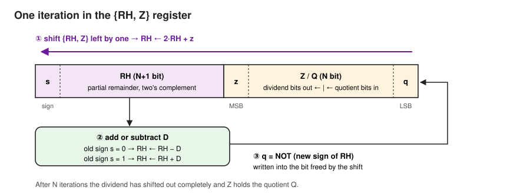
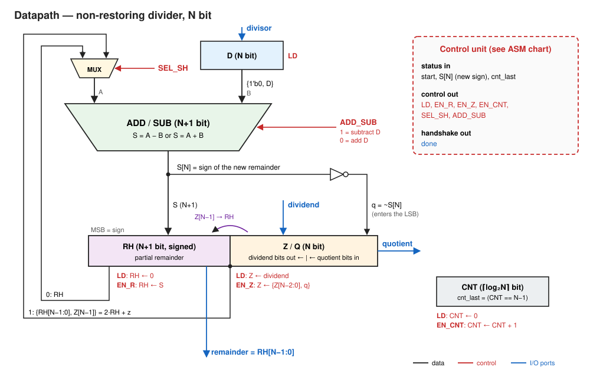
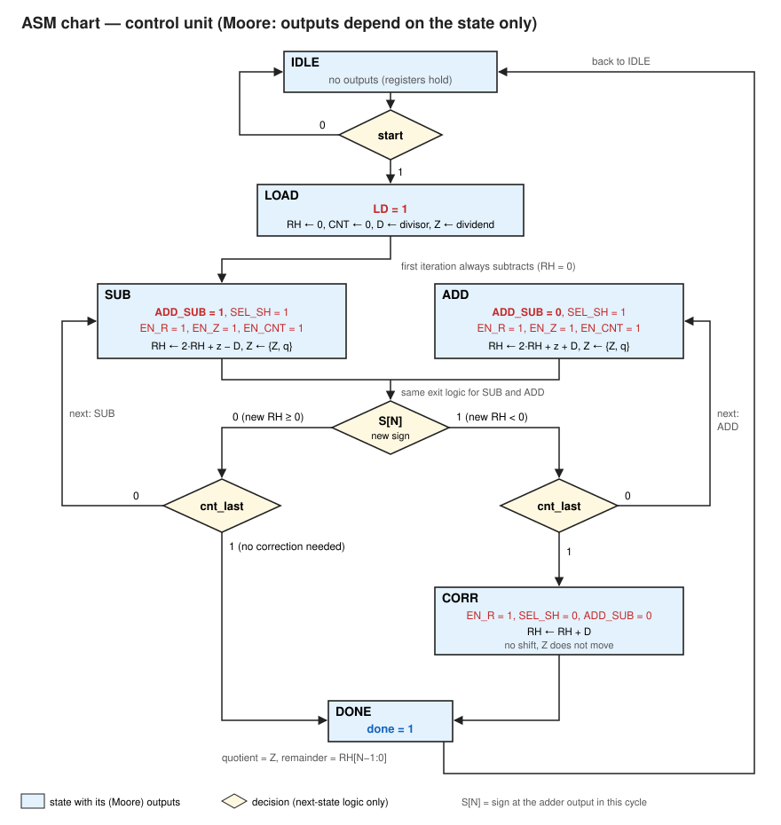
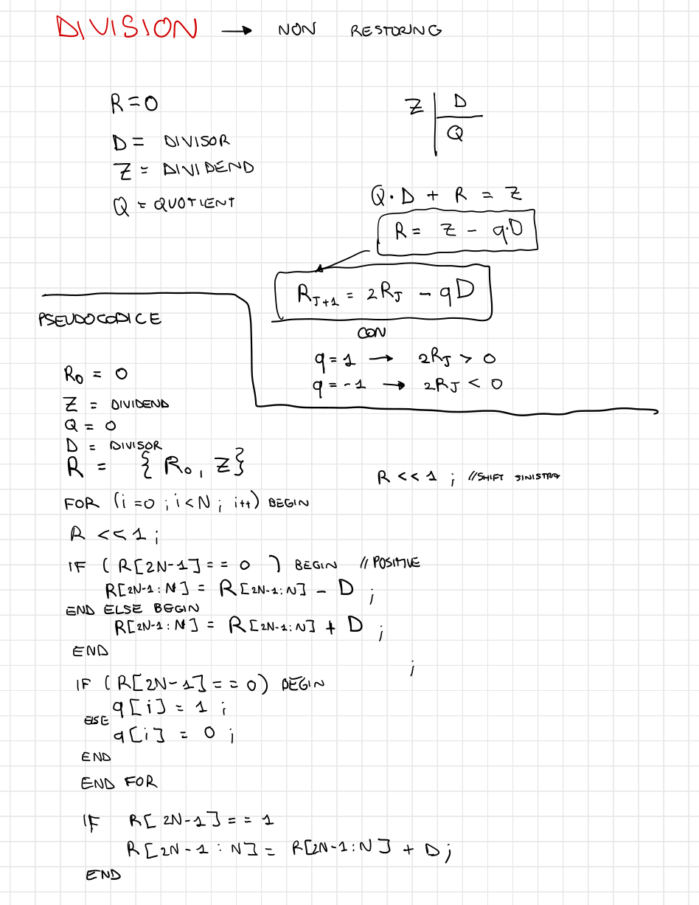
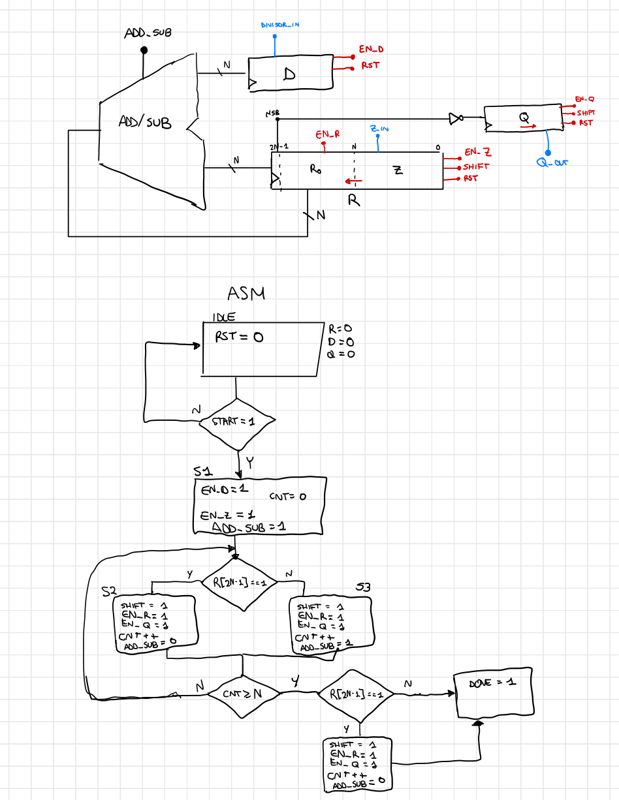

# Non-Restoring Divider in SystemVerilog

**A sequential N-bit unsigned integer divider built from scratch: from the algorithm to the
pseudocode, from the pseudocode to a datapath, from the datapath to an ASM chart, and from
there to a structural SystemVerilog implementation.**

The design computes, for an N-bit dividend `Z` and an N-bit divisor `D`,

```
Z = Q · D + R        with   0 ≤ R < D
```

producing the quotient `Q` and the remainder `R` in **N + 3 or N + 4 clock cycles**, using a single
(N+1)-bit adder/subtractor shared by every step of the algorithm. The quotient is built
**inside the dividend register itself**: there is no separate quotient register.

---

## Contents

- [1. Interface](#1-interface)
- [2. The algorithm](#2-the-algorithm)
  - [2.1 Restoring vs non-restoring](#21-restoring-vs-non-restoring)
  - [2.2 Why skipping the restore is legal](#22-why-skipping-the-restore-is-legal)
  - [2.3 One iteration, in registers](#23-one-iteration-in-registers)
- [3. Pseudocode](#3-pseudocode)
- [4. Worked example: 11 ÷ 4](#4-worked-example-11--4)
- [5. Datapath](#5-datapath)
- [6. Control unit: ASM chart](#6-control-unit-asm-chart)
- [7. SystemVerilog implementation](#7-systemverilog-implementation)
- [8. Verification](#8-verification)
- [9. From paper to RTL](#9-from-paper-to-rtl)

---

## 1. Interface

| Port | Dir | Width | Description |
|---|---|---|---|
| `clk` | in | 1 | clock, rising edge |
| `rst_n` | in | 1 | reset, active low |
| `start` | in | 1 | starts a division; operands are sampled in the next cycle (`LOAD`), so keep them stable until then |
| `dividend` | in | N | `Z` |
| `divisor` | in | N | `D` |
| `quotient` | out | N | `Q`, valid when `done = 1` |
| `remainder` | out | N | `R`, valid when `done = 1` |
| `done` | out | 1 | one-cycle pulse: the result is ready |

`N` is a parameter. Operands and results are **unsigned**.

| Metric | Value |
|---|---|
| Latency (start → done) | N + 3 cycles, or N + 4 when the remainder needs the final correction |
| Arithmetic | one (N+1)-bit adder/subtractor |
| State | `D` (N), `RH` (N+1), `Z`/`Q` (N), counter (⌈log₂N⌉) |
| Division by zero | no special case needed: returns `Q = 2^N − 1` (all ones) and `R = Z` (same convention as RISC-V `divu`/`remu`) |

---

## 2. The algorithm

Binary long division works exactly like the decimal one learned at school, but each quotient
digit can only be 0 or 1: at every step the partial remainder is shifted left by one, the next
dividend bit is brought down, and the divisor either fits (`q = 1`, subtract it) or it does not
(`q = 0`).

### 2.1 Restoring vs non-restoring

| | Restoring | Non-restoring |
|---|---|---|
| Per step | subtract `D`; if the result is negative, **add `D` back** (restore) | add **or** subtract `D`, never both |
| Operations per step | up to 2 (or 1 + a mux) | exactly 1 |
| Remainder during the loop | always ≥ 0 | may be negative (needs a sign bit) |
| Final fix-up | none | one correction of the remainder if it ends negative |

The non-restoring algorithm never undoes a subtraction. When the partial remainder goes
negative, it simply **adds** `D` in the next step instead of subtracting it.

### 2.2 Why skipping the restore is legal

Let `R` be the partial remainder before a step.

- A restoring divider that sees `R − D < 0` would restore `R`, then shift and subtract in the next
  step: `2R − D`.
- The non-restoring divider keeps the negative value `R − D`, shifts it and **adds**:
  `2(R − D) + D = 2R − D`.

Same value, one operation less. In general each step computes

```
R(j+1) = 2·R(j) − q(j)·D        with   q(j) = +1 if R(j) ≥ 0,   q(j) = −1 if R(j) < 0
```

The digits `q ∈ {+1, −1}` map back to ordinary binary quotient bits in the simplest possible way:
**the quotient bit of a step is 1 if the new partial remainder is ≥ 0, and 0 otherwise**. With this
encoding the quotient is already correct at the end of the loop. Only the remainder may need a
final correction: if it ends negative, `D` is added back once.

### 2.3 One iteration, in registers

The partial remainder and the dividend live in one long shift register `{RH, Z}`:

- `RH` (N+1 bits) is the partial remainder. It needs **one bit more than N**, because during the
  loop it ranges roughly from −2D to +2D and must carry a sign.
- `Z` (N bits) starts with the dividend. At every shift its MSB moves into `RH`, which is exactly
  "bring down the next bit", and its LSB becomes free. **The new quotient bit is written into
  that free LSB.** After N iterations every dividend bit has left `Z`, and `Z` contains the
  quotient.



Every iteration does three things:

1. **shift** `{RH, Z}` left by one: `RH ← 2·RH + z`, where `z` is the MSB of `Z`;
2. **add or subtract** `D` depending on the sign of `RH` **before** the operation;
3. **write** the quotient bit `q = NOT` (sign of `RH` **after** the operation) into the LSB of `Z`.

Two different signs are involved, and keeping them apart is the key to a correct design: the old
sign chooses the operation, the new sign gives the quotient bit.

---

## 3. Pseudocode

```
// inputs:  Z (dividend, N bit), D (divisor, N bit)
// outputs: Q (quotient, N bit), R (remainder, N bit)

RH = 0                                      // N+1 bit, two's complement

for i = 0 to N-1:
    {RH, Z} = {RH, Z} << 1                  // RH = 2*RH + MSB(Z); LSB of Z becomes free
    if (old RH >= 0)  RH = RH - D           // sign BEFORE the operation
    else              RH = RH + D
    Z[0] = (RH >= 0) ? 1 : 0                // quotient bit from the sign AFTER the operation

if (RH < 0)  RH = RH + D                    // correction: no shift, no quotient bit

Q = Z
R = RH[N-1:0]
```

Notes:

- Shifting `{RH, Z}` does not change the sign of `RH` (2·RH + z keeps the sign of RH when RH has
  N+1 bits), so "the sign before the operation" can be read either before or after the shift.
- Quotient bits come out **most significant first**. Writing each one into the LSB of `Z` and
  shifting left puts them in the right order automatically: the first bit produced ends up in
  the MSB after N shifts.
- The pseudocode was checked against `Z / D` and `Z % D` with a reference model, exhaustively for
  N = 4 (240 pairs) and N = 8 (65,280 pairs), divisor ≠ 0: 0 mismatches.

---

## 4. Worked example: 11 ÷ 4

N = 4, `Z = 1011` (11), `D = 0100` (4). Expected result: `Q = 2`, `R = 3`.

The last column shows the `Z` register: dividend bits leave from the left, quotient bits
(**bold**) enter from the right.

| Step | `RH` after shift (2·RH + z) | Operation (old sign) | New `RH` | `q` | `Z` |
|---|---|---|---|---|---|
| load | — | — | 0 | — | `1011` |
| 1 | 2·0 + 1 = 1 | ≥ 0 → − D | −3 | 0 | `011`**`0`** |
| 2 | 2·(−3) + 0 = −6 | < 0 → + D | −2 | 0 | `11`**`00`** |
| 3 | 2·(−2) + 1 = −3 | < 0 → + D | 1 | 1 | `1`**`001`** |
| 4 | 2·1 + 1 = 3 | ≥ 0 → − D | −1 | 0 | **`0010`** |
| correction | — | RH < 0 → + D | **3** | — | **`0010`** |

Result: `Q = 0010 = 2`, `R = 3`, and indeed 2 · 4 + 3 = 11. In this example the correction step
is needed: the loop ends with a negative remainder (−1) and adding `D` once gives the true one.

---

## 5. Datapath



### Components

| Block | Width | Role |
|---|---|---|
| `D` register | N | holds the divisor, loaded once (`LD`) |
| `RH` register | N+1 | partial remainder, signed; cleared on `LD`, loaded with `S` on `EN_R` |
| `Z`/`Q` register | N | loaded with the dividend on `LD`; on `EN_Z` shifts left and takes `q` in its LSB; holds the quotient at the end |
| A-input mux | N+1 | selects the shifted value `{RH[N-1:0], Z[N-1]}` (iterations) or `RH` itself (correction) |
| ADD/SUB | N+1 | `S = A − {0, D}` when `ADD_SUB = 1`, `S = A + {0, D}` when `ADD_SUB = 0` |
| inverter | 1 | `q = ~S[N]`: quotient bit from the sign of the **new** remainder |
| counter | ⌈log₂N⌉ | counts the iterations; `cnt_last = (CNT == N−1)` |

### Control and status signals

| Signal | Direction | Meaning |
|---|---|---|
| `LD` | control | load operands, clear `RH` and `CNT` |
| `EN_R` | control | `RH ← S` |
| `EN_Z` | control | `Z ← {Z[N-2:0], q}` |
| `EN_CNT` | control | `CNT ← CNT + 1` |
| `SEL_SH` | control | 1: adder sees the shifted remainder; 0: adder sees `RH` (correction) |
| `ADD_SUB` | control | 1: subtract `D`; 0: add `D` |
| `S[N]` | status | sign of the remainder being computed (adder output) |
| `cnt_last` | status | this is the last iteration |
| `start` | input | begin a division |
| `done` | output | result ready |

### Design decisions

1. **The shift is wiring, not a register mode.** The adder reads `{RH[N-1:0], Z[N-1]}`, which
   is `2·RH + z` with no logic at all, and in the same clock edge `RH` loads the adder output
   while `Z` shifts. One iteration therefore takes **one cycle**, and no register ever has to
   choose between "shift" and "load".
2. **The quotient lives in `Z`.** Each shift frees exactly one bit at the right end of `Z`, and
   each iteration produces exactly one quotient bit: they fit perfectly. A separate quotient
   register would cost N extra flip-flops and an extra enable for no benefit.
3. **One adder for everything.** The iterations and the final correction share the same
   adder/subtractor; the mux on its A input is the only cost of reusing it.
4. **`RH` has N+1 bits.** With N bits the sign would be lost as soon as the remainder exceeds
   half the range, or when the shift pushes the old sign out of the register.
5. **The quotient bit comes from the adder output, not from the register.** `RH[N]` read from
   the register is the sign of the *previous* iteration; `S[N]` is the sign of the remainder
   being written in this cycle. Taking it from the register would delay every quotient bit by
   one iteration.
6. **The operation is chosen by the state.** Whether the next iteration adds or subtracts is
   decided at the end of the current one, from `S[N]`, and stored in the state (`SUB` or `ADD`).
   `ADD_SUB` is then a plain output of the state register: it is stable for the whole cycle and
   does not wait for any arithmetic.

---

## 6. Control unit: ASM chart



The control unit is a **Moore machine**: every output depends only on the current state. The
status signals (`start`, `S[N]`, `cnt_last`) are used exclusively by the next-state logic.

| State | Outputs | Next state |
|---|---|---|
| `IDLE` | — | `start ? LOAD : IDLE` |
| `LOAD` | `LD = 1` | `SUB` (the first iteration always subtracts, because `RH = 0`) |
| `SUB` | `ADD_SUB = 1`, `SEL_SH = 1`, `EN_R`, `EN_Z`, `EN_CNT` | see below |
| `ADD` | `ADD_SUB = 0`, `SEL_SH = 1`, `EN_R`, `EN_Z`, `EN_CNT` | see below |
| `CORR` | `EN_R = 1`, `SEL_SH = 0`, `ADD_SUB = 0` | `DONE` |
| `DONE` | `done = 1` | `IDLE` |

`SUB` and `ADD` share the same exit logic, driven by the sign of the remainder they are writing:

```
if (!cnt_last)  next = S[N] ? ADD  : SUB     // keep iterating: add if the new remainder is negative
else            next = S[N] ? CORR : DONE    // last iteration: correct only a negative remainder
```

How the three data-dependent decisions became Moore:

- **Loading the operands** has its own state, `LOAD`, instead of being a conditional output of
  `IDLE` on `start`.
- **Add or subtract** is not an output that follows the sign: it is the **state itself**. The
  sign of the new remainder `S[N]` selects whether the next state is `SUB` or `ADD`.
- **The correction** is not a conditional write inside a correction state: `CORR` is entered
  only when the final remainder is negative, and then it always writes `RH ← RH + D`.

Timing rules that the chart encodes:

- **Registers update on the clock edge that leaves a state.** A decision reads the values that
  are in the registers (and at the adder output) *during* that cycle. For the counter this means
  `cnt_last = (CNT == N−1)`, not `CNT == N`: checking the value after the increment would run
  one iteration too many.
- **`S[N]` is the sign of the remainder being written in this cycle**, so it is exactly the
  "old sign" of the next iteration and the quotient bit of this one (`q = ~S[N]`).
- **The correction does not shift.** It only adds `D` to `RH`; `Z` does not move, and no
  quotient bit is produced.
- **`DONE` returns to `IDLE`**, so a new division can start in the cycle right after `done`.
  The results stay in `Z` and `RH` until the next `start`.

Cycle count for one division: `IDLE → LOAD → (SUB|ADD) × N → [CORR] → DONE`, that is
**N + 3 cycles**, or **N + 4** when the correction is needed, counting from the cycle in which
`start` is seen to the cycle in which `done` is high. The FSM and datapath were simulated
together against a reference model for every N = 8 operand pair: 0 mismatches, latency 11 or
12 cycles.

---

## 7. SystemVerilog implementation

The RTL follows the datapath and the ASM chart one to one: every block of the datapath figure
is an instance, every arrow is a wire, and the control unit is the ASM chart written as a
Moore FSM.

### 7.1 Files

| File | Content |
|---|---|
| [`src/divisor.sv`](src/divisor.sv) | top level: structural datapath and control unit |
| [`src/register.sv`](src/register.sv) | N-bit register with synchronous clear (`ld`) and load enable (`en_reg`) |
| [`src/mux21.sv`](src/mux21.sv) | 2:1 multiplexer |
| [`src/add_sub.sv`](src/add_sub.sv) | adder/subtractor built on the Kogge-Stone adder |
| [`src/kogge_stone.sv`](src/kogge_stone.sv) | parallel-prefix Kogge-Stone adder: PG network, `G` and `PG` cells |
| [`src/counter.sv`](src/counter.sv) | iteration counter with the `cnt_last` flag |
| [`tb/tb_divisor.sv`](tb/tb_divisor.sv) | self-checking testbench |

### 7.2 Hierarchy

```
divisor
├── u_d        register    (N)     D
├── u_mux_a    mux21       (N+1)   A input of the adder
├── u_addsub   add_sub     (N+1)
│   └── adder  kogge_stone (N+1)
│       ├── network  PG_network
│       └── u_G / u_PG   G_block / PG_block cells
├── u_rh       register    (N+1)   RH
├── u_mux_z    mux21       (N)     Z input
├── u_z        register    (N)     Z / Q
└── u_cnt      counter
```

### 7.3 Datapath

The signal names in the code are the ones of the datapath figure, in lower case:

| Figure | Code | Note |
|---|---|---|
| `LD`, `EN_R`, `EN_Z`, `EN_CNT`, `SEL_SH`, `ADD_SUB` | `ld`, `en_r`, `en_z`, `en_cnt`, `sel_sh`, `add_sub` | control signals |
| `S[N]` | `s_sign` | status signal to the FSM |
| `q = ~S[N]` | `q_bit` | quotient bit |
| `{RH[N-1:0], Z[N-1]}` | `rh_sh` | the shift, as wiring |

The three registers use the same `register` block in three different ways:

- **`D`**: `en_reg = ld`, never cleared. It is written once, in `LOAD`.
- **`RH`**: `ld` clears it, `en_r` loads the adder output `s`.
- **`Z`**: a mux in front of the register selects the dividend when `ld = 1` and the shifted
  value `{Z[N-2:0], q_bit}` otherwise; the enable is `ld | en_z`.

**Adder/subtractor.** `add_sub` computes `A − B` as `A + ~B + 1`: B goes through a row of XOR
gates controlled by `add_sub`, and the same signal enters as carry-in. The adder underneath is
a Kogge-Stone parallel-prefix adder with ⌈log₂(N+1)⌉ levels (6 levels for N = 32, where the
adder is 33 bits wide). The carry-in is folded into the generate signal of bit 0, so the
prefix tree needs no extra column.

**Counter.** `cnt_last = (cnt == N−1)` is combinational, so it is high *during* the last
iteration, when the FSM has to decide whether to leave the loop.

### 7.4 Control unit

The FSM is written with three processes:

1. **state register** (`always_ff`), with synchronous active-low reset to `IDLE`;
2. **next-state logic** (`always_comb`), a `case` on the current state that reads `start`,
   `s_sign` and `cnt_last`;
3. **output logic** (`always_comb`): every output is first set to 0, then the `case` on the
   current state raises the outputs of that state.

The states are an `enum` (`IDLE, LOAD, SUB, ADD, CORR, DONE`). The outputs depend only on the
state, as in the ASM chart, and the default assignments before the `case` prevent latches.

---

## 8. Verification

### 8.1 Testbench

[`tb/tb_divisor.sv`](tb/tb_divisor.sv) instantiates the divider with N = 8 and runs 15
divisions chosen to cover the interesting cases:

| Case | Divisions |
|---|---|
| example of section 4 (needs the correction) | 11 ÷ 4 |
| no correction | 173 ÷ 13, 250 ÷ 7 |
| exact division | 100 ÷ 10 |
| `Z = D`, `Z < D`, `Z = 0` | 7 ÷ 7, 3 ÷ 5, 0 ÷ 9 |
| `D = 1` | 200 ÷ 1, 255 ÷ 1 |
| MSB of `Z` set | 128 ÷ 3 |
| largest values | 255 ÷ 255, 255 ÷ 2, 1 ÷ 255 |
| division by zero | 200 ÷ 0, 0 ÷ 0 |

For every division the testbench drives the operands and `start` on the falling edge, waits
for `done`, and compares `quotient` and `remainder` with a **golden model**: `Z / D` and
`Z % D`, or `Q = 2^N − 1`, `R = Z` when `D = 0`. A division that never raises `done` is
reported as a timeout. At the end it prints `PASS`, or `FAIL` with the number of errors.

### 8.2 Running it

With [Verilator](https://www.veripool.org/verilator/) 5:

```bash
verilator --binary --timing --top-module tb_divisor tb/tb_divisor.sv src/*.sv
./obj_dir/Vtb_divisor
```

```
ok        11 /   4 : Q =   2 R =   3
ok       173 /  13 : Q =  13 R =   4
...
ok       200 /   0 : Q = 255 R = 200
ok         0 /   0 : Q = 255 R =   0
PASS
```

### 8.3 Results

| Test | Result |
|---|---|
| testbench above, N = 8, 15 divisions | `PASS` |
| N = 8, exhaustive: all 65,536 operand pairs, division by zero included | 0 mismatches |
| N = 32, 200,000 random divisions, some by zero | 0 mismatches |
| latency | N + 3 or N + 4 cycles (11–12 for N = 8, 35–36 for N = 32) |

---

## 9. From paper to RTL

The design started on paper. These are the original hand-written notes:

| Pseudocode | Datapath and ASM chart |
|---|---|
|  |  |

Moving from the sketch to the final design meant fixing exactly the details that make a
sequential divider correct, and removing one register:

| First sketch | Final design | Why |
|---|---|---|
| remainder on N bits | `RH` on **N+1** bits | the partial remainder needs a sign bit |
| quotient written as `q[i]`, `i = 0..N−1` | quotient bit written into the LSB of `Z` | the MSB of the quotient is produced first; shifting puts it in place |
| separate `Q` register | quotient stored in the bits freed in `Z` | one register less, same behaviour |
| shift and load enabled together on `R` | shift implemented as wiring into the adder | one well-defined register update per cycle |
| quotient bit taken from the register MSB | taken from the adder output `S[N]` | the register still holds the previous sign |
| correction state also shifting | correction only adds `D` to `RH` | the correction is not an iteration |
| loop exit on `CNT ≥ N` | `cnt_last = (CNT == N−1)` | the decision sees the counter before the increment |
| two iteration states S2 / S3, chosen by the register sign | `SUB` / `ADD` states, the next one chosen by the sign of the new remainder `S[N]` | the decision must use the remainder just computed |
| `DONE` without exit | `DONE → IDLE` | the unit must accept the next division |

---

**Author:** Raffaele Negri
